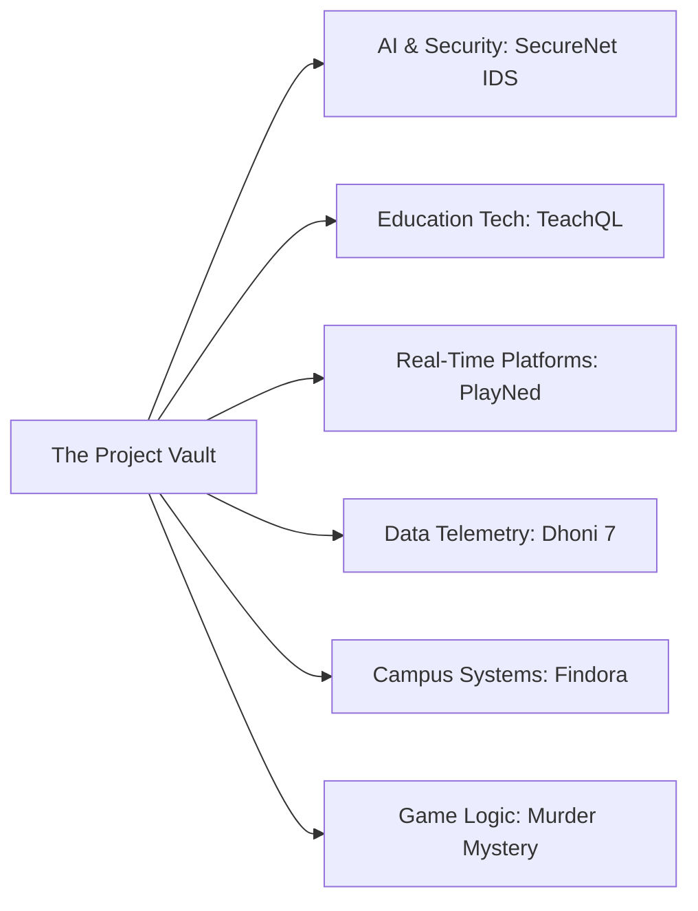

<div align="center">

<!-- ========================================================================= -->
<!--                           CHAPTER 0: THE OPENING                          -->
<!-- ========================================================================= -->


<p align="center">
  <b>Computer Science & Engineering Undergrad</b> • <b>United Institute of Technology, Prayagraj</b><br>
  <i>Merging mechanical discipline with distributed software, intelligent agents, and defensive systems.</i>
</p>

<!-- IDENTITY HUBS -->
<p align="center">
  <a href="https://pathakpk7portfolio.vercel.app/" target="_blank">
    
  </a>
  &nbsp;
  <a href="https://pathakpk7blog.vercel.app/" target="_blank">
    
  </a>
  &nbsp;
  <a href="https://www.linkedin.com/in/prasoon7pathak07" target="_blank">
    
  </a>
  &nbsp;
  <a href="https://leetcode.com/u/pathakMahi/" target="_blank">
    
  </a>
  &nbsp;
  <a href="https://twitter.com/panditpk7" target="_blank">
    
  </a>
</p>

<!-- CHAPTER NAVIGATION RADAR -->
<table align="center" style="border: 1px solid #1e293b; border-radius: 6px; background-color: #0b0f19;">
  <tr>
    <td align="center">
      <code>[ INDEX ]</code> &nbsp;
      <a href="#-chapter-1--the-story-behind-the-builder"><code>01. The Story</code></a> &nbsp;•&nbsp;
      <a href="#-chapter-2--the-technologies-i-explore"><code>02. Technical Matrix</code></a> &nbsp;•&nbsp;
      <a href="#-chapter-3--the-project-vault"><code>03. Project Vault</code></a> &nbsp;•&nbsp;
      <a href="#-chapter-4--the-problem-solving-log"><code>04. Problem Solving</code></a> &nbsp;•&nbsp;
      <a href="#-chapter-5--the-activity-observatory"><code>05. Observatory</code></a> &nbsp;•&nbsp;
      <a href="#-chapter-6--beyond-the-terminal"><code>06. Beyond Code</code></a> &nbsp;•&nbsp;
      <a href="#-chapter-7--the-next-experiment"><code>07. Next Horizon</code></a> &nbsp;•&nbsp;
      <a href="#-chapter-8--the-open-door"><code>08. Transmission</code></a>
    </td>
  </tr>
</table>

</div>

---

### 📖 CHAPTER 1 // THE STORY BEHIND THE BUILDER

I am a software builder who approaches code through the lens of engineering systems. 

Before committing to Computer Science, I earned a **Diploma in Mechanical Engineering (Production)** at *Chandauli Polytechnic* (graduating with a 75.6% distinction). Physical engineering taught me how stress distributes across structures, how tolerances dictate reliability, and why catastrophic failures almost always stem from overlooked edge cases.

When I transitioned into **Computer Science and Engineering at United Institute of Technology, Prayagraj**, I carried that mechanical intuition into the digital realm. To me:
- A database schema is a structural load-bearing frame.
- Network throughput and API latency are fluid dynamics problems.
- Defensive cybersecurity is stress analysis under adversarial load.

I don't build software just to see syntax run; I build to turn ideas into resilient tools that people can rely on. Whether that means isolating SQL execution in WebAssembly sandboxes, deriving intrusion signatures from network packet flows, or decoding decades of sports data through high-precision telemetry, my drive remains constant: **understand how the machine works, then build it better.**

---

### 🛠️ CHAPTER 2 // THE TECHNOLOGIES I EXPLORE

I treat technologies as instruments in a workshop: selected for the problem at hand, evaluated on their trade-offs, and learned through practical implementation.

<table width="100%">
<tr>
<td width="50%" valign="top">

#### ⚡ Core Languages
*Systems, algorithms, and high-performance scripting*
- **Python** — Machine learning, network packet parsing, asynchronous APIs
- **TypeScript & JavaScript** — Full-stack web architectures, type-safe runtimes
- **C & C++** — Foundational data structures, memory models, algorithmic efficiency
- **Java** — Object-oriented architecture, concurrent programming
- **SQL (PostgreSQL / MySQL)** — Relational modeling, indexing, schema design *(Oracle 97% Foundations Score)*

#### 🌐 Frontend Engineering
*Accessible, high-precision user interfaces & 3D canvases*
- **React & Next.js (App Router)** — Modern component trees, SSR/SSG pipelines
- **Tailwind CSS** — Systematic design tokens, responsive layouts
- **Three.js** — Interactive 3D viewports and ambient graphic scenes
- **HTML5 & Modern CSS** — Semantic structure, fluid typography, animations

</td>
<td width="50%" valign="top">

#### ⚙️ Backend, Systems & Data Stores
*Microservices, real-time protocols & transactional persistence*
- **FastAPI & Node.js (Express)** — Asynchronous REST APIs, WebSocket streaming
- **PostgreSQL & Supabase** — Relational schemas, Row-Level Security (RLS)
- **Neon DB** — Serverless PostgreSQL branching and cloud architectures
- **Prisma ORM** — Declarative schema modeling, automated migrations
- **MongoDB** — Document collections, Atlas vector index integration

#### 🛡️ AI, Data & Developer Tooling
*Intelligence pipelines, packet telemetry & developer workflow*
- **Machine Learning**: Scikit-learn, TensorFlow, Random Forest, Pandas, NumPy
- **Generative AI & RAG**: LangChain, ChromaDB, Gemini API, Hugging Face
- **Network & Telemetry**: PyShark, Wireshark, Npcap, Cisco Packet Tracer
- **Workflow & DevOps**: Git, GitHub Actions, Docker, Linux, Postman, VS Code

</td>
</tr>
</table>

<details>
<summary><b>🔍 View Technology Verified Certifications & Accreditations</b></summary>
<br>

| Credential | Issuer | Focus / Achievement |
| :--- | :--- | :--- |
| **Databases for Developers: Foundations** | Oracle | Scored **97%** — Relational algebra, SQL, constraints, DDL/DML |
| **Building AI Agents with MongoDB** | MongoDB | Vector embeddings, search indexes, agentic workflows |
| **Databricks Fundamentals Accreditation** | Databricks | Lakehouse paradigm, distributed compute, big data architectures |
| **Fundamentals of AI Security** | Microsoft Learn | AI threat vectors, adversarial defense, prompt boundary validation |
| **Introduction to Cybersecurity** | Cisco Academy | Network security, CIA triad, threat mitigation, Packet Tracer |
| **Deloitte Data Analytics Simulation** | Deloitte × Forage | Exploratory data analysis, forensic insights, Tableau dashboards |

</details>

---

### 🏛️ CHAPTER 3 // THE PROJECT VAULT

A curated collection of systems I have engineered. Each represents a distinct technical challenge, architectural decision, and domain of interest.



<br>

#### 01. SECURENET IDS — AI-Powered Intrusion Detection System
*Real-time network packet capture, flow feature extraction, and malicious anomaly classification.*

- **The Idea:** Network intrusion detection is often split between low-level sniffers and complex enterprise SIEMs. SecureNet IDS unifies real-time traffic capture, automated feature extraction, and machine learning classification into a singular, observable platform.
- **The Engine:** `Python` • `FastAPI` • `TensorFlow` • `Scikit-learn` • `PyShark` • `React` • `PostgreSQL`
- **The Interesting Part:** Trained on the benchmark **CICIDS2017** dataset, the Random Forest engine extracts flow-level metrics from raw live packet streams and achieves a verified **99.56% detection accuracy** while streaming threat vectors into an interactive React telemetry UI.
- **Explore:** [GitHub Repository (`SecureNet_IDS`)](https://github.com/pathakpk7/SecureNet_IDS)

<details>
<summary><b>View System Architecture Flow</b></summary>

```
 [Live Packet Stream] ➔ [PyShark / Npcap Sniffer] ➔ [Flow Feature Normalizer]
                                                             │
                                                             ▼
 [React Security Dashboard] ◀── [FastAPI WebSockets] ◀── [Random Forest Classifier]
```
</details>

---

#### 02. TEACHQL — Multi-Class SQL Learning & Assessment Platform
*Production-ready database education environment with an isolated browser-side execution sandbox.*

- **The Idea:** Learning SQL often suffers from either rigid multiple-choice tests or clunky server setups vulnerable to injection and database crashes. TeachQL gives classrooms an isolated, safe SQL workbench with automated multi-criteria evaluation.
- **The Engine:** `Next.js 16+` • `TypeScript` • `Tailwind CSS` • `Supabase PostgreSQL` • `Row-Level Security`
- **The Interesting Part:** Features an in-memory SQL execution sandbox equipped with an automated security guard that safely blocks destructive commands (`DROP`, `TRUNCATE`, `ALTER`). Includes automated test normalization that evaluates query results against reference outputs while respecting order-sensitive vs. order-insensitive expectations.
- **Explore:** [GitHub Repository (`TeachQL`)](https://github.com/pathakpk7/TeachQL)

---

#### 03. PLAYNED — Modular 2D Multiplayer Gaming Platform
*Real-time distributed turn-based gaming engine with clean architectural decoupling.*

- **The Idea:** Casual multiplayer web games frequently couple game logic directly with network sockets, making new game additions messy and brittle. PlayNed separates platform infrastructure from deterministic rule engines.
- **The Engine:** `Flutter (Dart)` • `FastAPI` • `Python 3.13` • `WebSockets` • `Neon PostgreSQL`
- **The Interesting Part:** The core platform handles rooms, matchmaking, and state broadcasting generically. New deterministic engines (e.g., *Hangman Reimagined* with a 38,700-word corpus, *Quoridor* with BFS shortest-path wall validators, and *Pentago* with 90° rotating quadrants) plug directly into an abstract game interface without touching network code.
- **Explore:** [GitHub Repository (`PlayNed`)](https://github.com/pathakpk7/PlayNed)

---

#### 04. CAPTAIN COOL: DECODED (DHONI 7) — High-Precision Cricket Data Warehouse
*Cinematic interactive documentary and verified 20-year ball-by-ball analytical suite.*

- **The Idea:** Cricket discourse is full of narratives; this project grounds narrative in empirical precision. It decodes the 20-year career of MS Dhoni across 826 matches and 25,541+ deliveries.
- **The Engine:** `Next.js 14+` • `TypeScript` • `Tailwind CSS` • `Framer Motion` • `Python ETL` • `Prisma` • `PostgreSQL`
- **The Interesting Part:** An end-to-end Python data pipeline downloads, validates, and normalizes raw Cricsheet archives. On the frontend, a 17-module deep telemetry suite computes head-to-head dominance matrices against every bowler faced, alongside a digital book experience featuring realistic 3D page flips synthesized via the Web Audio API.
- **Explore:** [GitHub Repository (`Dhoni_7`)](https://github.com/pathakpk7/Dhoni_7)

---

#### 05. FINDORA — Smart Campus Lost & Found Platform
*Centralized campus platform streamlining item reporting, claim verification, and resolution.*

- **The Idea:** University campuses depend on scattered WhatsApp groups and social media threads to recover lost items. Findora centralizes discovery with verified claim workflows.
- **The Engine:** `Next.js` • `React` • `TypeScript` • `Tailwind CSS` • `Supabase PostgreSQL` • `Prisma`
- **The Interesting Part:** Implements strict identity verification protocols and structured metadata filtering (location, time bracket, item taxonomy) to prevent false claims and protect student privacy.
- **Explore:** [GitHub Repository (`Findora`)](https://github.com/pathakpk7/Findora)

---

#### 06. MURDER MYSTERY GAME — Event-Driven Deduction Simulator
*Non-linear web mystery game with branching logic and state-driven clue trees.*

- **The Idea:** To build an interactive detective game where player deductions dictate the narrative outcome rather than static linear scripts.
- **The Engine:** `JavaScript` • `HTML5` • `CSS3` • `Tailwind CSS` • `PostgreSQL`
- **The Interesting Part:** Built using an event-driven state engine where discovered clues dynamically unlock dialogue trees, validate hypotheses against witness statements, and lead to multiple divergent endings.
- **Explore:** [Live Game Experience](https://murder-mystery-game-nine.vercel.app/) • [GitHub Repository (`Murder_Mystery_Game`)](https://github.com/pathakpk7/Murder_Mystery_Game)

---

### 🧠 CHAPTER 4 // THE PROBLEM-SOLVING LOG

I view algorithmic problem solving not as an interview ritual, but as continuous strength training for system design. It builds intuition for time-space trade-offs, cache efficiency, and edge-case handling.

<div align="center">

<p align="center">
  <a href="https://leetcode.com/u/pathakMahi/" target="_blank">
    
  </a>
</p>

<p align="center">
  <a href="https://leetcode.com/u/pathakMahi/" target="_blank">
    
  </a>
  &nbsp;&nbsp;
  <a href="https://www.geeksforgeeks.org/user/prasoon7pathak/" target="_blank">
    
  </a>
  &nbsp;&nbsp;
  <a href="https://kaggle.com/pathakpk07" target="_blank">
    
  </a>
</p>

</div>

- **Focus Areas**: Arrays, Hash Maps, Two-Pointers, Dynamic Programming, Graph Traversals (BFS/DFS), Binary Search, and Tree traversals.
- **Relational Mastery**: Complex SQL joins, window functions, recursive CTEs, and query indexing validated by a **97% score in Oracle Database Foundations**.

---

### 🔭 CHAPTER 5 // THE ACTIVITY OBSERVATORY

A snapshot of my active development rhythm, commit consistency, and codebase exploration on GitHub:

<div align="center">

<p align="center">
  <a href="https://github.com/pathakpk7">
    
  </a>
  &nbsp;
  <a href="https://github.com/pathakpk7">
    
  </a>
</p>

</div>

---

### 🌌 CHAPTER 6 // BEYOND THE TERMINAL

Code is one medium of expression, but curiosity extends far past the code editor.

<table width="100%">
<tr>
<td width="55%" valign="top">

#### ✍️ The Editorial: [ThePathak.tech](https://pathakpk7blog.vercel.app/)
I write independent technical essays and reflective pieces to clarify my thoughts and share hard-earned lessons:

- [**The AI Race: How Fast Is Too Fast?**](https://pathakpk7blog.vercel.app/article/the-ai-race-has-reached-an-uncomfortable-question-how-fast-is-too-fast)  
  *On frontier model deployment, runaway acceleration, and the human responsibility of control.*
- [**I Stopped Asking AI to Write My Code — This Workflow Worked Better**](https://pathakpk7blog.vercel.app/article/i-stopped-asking-ai-to-write-my-code-this-workflow-worked-better)  
  *Retaining engineering ownership and deliberate problem-solving in an age of automated assistants.*
- [**अपना धर्म निभाना पड़ता है**](https://pathakpk7blog.vercel.app/article/apna-dharm-nibhana-padta-hai)  
  *A personal Hindi reflection on discipline, duty, and quiet resilience when facing uphill battles.*

</td>
<td width="45%" valign="top">

#### 🏏 Strategic Interests & Play
- **Cricket Analytics & Tactics**: Fascinated by match situations, field-setting geometry, and high-pressure decision trees (which birthed the *Dhoni 7* data warehouse).
- **Physical Sports**: Active player of Badminton, Volleyball, and Chess — where spatial awareness and rapid adaptation mirror system design under load.
- **Experimental Prototyping**: Constantly testing new developer workflows, CLI tools, and browser micro-interactions.

</td>
</tr>
</table>

---

### 🚀 CHAPTER 7 // THE NEXT EXPERIMENT

I am actively focusing my research and engineering efforts on three frontiers:

1. **Autonomous Security Agents**: Evolving *SecureNet IDS* from passive classification to automated incident response workflows (SOAR) using agentic models.
2. **Distributed Real-Time Systems**: Building zero-latency state synchronization engines using WebSockets and WebRTC for collaborative web platforms.
3. **Generative AI with Hard Grounding**: Expanding hybrid search (dense embeddings + lexical BM25) to eliminate hallucinations in sensitive domains like legal and healthcare documentation.

---

### 📬 CHAPTER 8 // THE OPEN DOOR

Whether you want to discuss a distributed architecture, critique a technical article, collaborate on an open-source project, or talk cricket telemetry, my door is always open.

<div align="center">

<p align="center">
  <a href="https://pathakpk7portfolio.vercel.app/" target="_blank">
    
  </a>
  &nbsp;&nbsp;
  <a href="https://pathakpk7blog.vercel.app/" target="_blank">
    
  </a>
  &nbsp;&nbsp;
  <a href="https://www.linkedin.com/in/prasoon7pathak07" target="_blank">
    
  </a>
  &nbsp;&nbsp;
  <a href="mailto:prasoon7pathak@gmail.com">
    
  </a>
</p>

<br>

```
"Don't just write code that executes. Build architectures that endure."
```


<p align="center">
  <sub>Designed & engineered with architectural precision by <b><a href="https://github.com/pathakpk7">Prasoon Pathak</a></b></sub>
</p>

</div>
